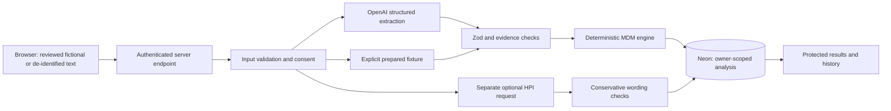

# MedCode AI

**Bill accurately. Document confidently. Understand why.**

MedCode AI is a full-stack portfolio application for learning how hospitalist documentation supports medical decision-making (MDM) and potential hospital E/M CPT codes. It separates AI-assisted interpretation from a deterministic TypeScript rules engine and shows the evidence and uncertainty behind each assessment.

> Portfolio demonstration only. Fictional or fully de-identified notes only. Not intended for patient care or actual billing decisions.

**Never enter identifying patient information.** Real-case notes must be fully de-identified before entering this app, not merely have names removed. Users must be authorized to use them. Automated screening cannot certify de-identification; see [HHS guidance](https://www.hhs.gov/hipaa/for-professionals/special-topics/de-identification/index.html). This application is not HIPAA-compliant and has not been clinically or billing validated.

[Existing public deployment](https://med-code-ai-eight.vercel.app) ? [Phase 3 verification](#phase-3-verification--october-28-2026) ? [Local setup](#local-setup) ? [Vercel release](#vercel-release)

The existing deployment does not automatically include these uncommitted import/source-selection changes. Deployment requires owner approval.

## Problem statement

Clinical documentation can be lengthy without clearly showing which problems were addressed, which diagnostic activities occurred, or which management decisions were made. MedCode AI lets learners examine fictional or fully de-identified notes, distinguish those elements, and ask clarification questions without inventing missing work or treating clearer wording as justification for a higher code.

## Features

- Email/password registration with password confirmation, normalized email, bcrypt hashing at cost 12, Auth.js Credentials login/logout, and eight-hour JWT sessions.
- Protected dashboard, paginated History, and saved analyses scoped to the authenticated user in every data query. Recent analyses include a delete button with confirmation; deletion permanently removes the saved record from the dashboard and History. The server requires authentication, same-origin requests, and an atomic owner-scoped delete.
- Fictional or fully de-identified real-case source declarations, explicit privacy checks, and browser-only PDF/DOCX/TXT extraction with an editable review step. Original files and filenames are not uploaded.
- Admission H&P and Progress Note workflows; full-note input or optional collapsible sections. In-memory drafts survive mode switches while the form remains mounted. Only active fields are submitted.
- Laboratory, cardiac, imaging, other diagnostic studies, data activities, history/examination, and assessment/plan fields. At least one active documentation field is required.
- Optional HPI organization with original/suggested wording, source evidence, clarification questions, and a copy action. Original documentation is never overwritten.
- Server-side OpenAI Responses requests with strict JSON Schema, numbered source references resolved to exact original excerpts, Zod validation, bounded input, and safe refusal/error handling.
- Separate problems/data/risk assessments, a two-of-three MDM calculation, potential encounter-family CPT mapping, and indeterminate results where uncertainty changes the conclusion.
- Progressive results showing source facts, clinical interpretations, coding-rule conclusions, exclusions, and uncertainty.
- Twelve original fictional examples: six core admission/progress cases and six focused worksheet teaching cases. Prepared examples work without OpenAI and are clearly labeled as fixtures.
- Responsive navy/white/soft-blue/teal styling, labeled controls, keyboard focus, skip link, loading/error feedback, reduced-motion support, and privacy notices.

The selected initial/subsequent hospital inpatient/observation family is an explicit assumption. A note title alone does not establish service eligibility. Time-based billing is outside this MVP.

## Technology

| Layer | Implementation |
| --- | --- |
| UI and server | Next.js 16 App Router, React 19, TypeScript |
| Styling | Tailwind CSS 4 and application CSS; Lucide icons |
| Authentication | Auth.js v5 Credentials, pinned beta; bcryptjs |
| Database | Neon PostgreSQL; Prisma 7 with PostgreSQL adapter and `pg` |
| AI | OpenAI Responses REST API; strict JSON Schema and Zod |
| Rules/tests | TypeScript MDM module; Node test runner and local HTTP smoke tests |
| Hosting | Vercel, Node.js runtime |

Use Node.js 24 LTS and npm. The lockfile pins the dependency tree; use `npm ci`. There is no required OpenAI SDK package because the server uses `fetch`.

## Architecture



HPI output never enters the coding engine. Live extraction and optional HPI requests run in parallel, each with a 40-second provider timeout; the analysis route declares a 60-second maximum duration. Database pool acquisition and queries are bounded. If provider validation or persistence fails, the endpoint returns a safe error rather than a partial saved assessment. A client connection interruption may occur after saving; the error message advises checking History before retrying.

Live extraction receives numbered original source spans and cites integer references instead of rewriting quotes. A transport-only schema separates clinical problems, management decisions, and explicit service-category conflicts. The server resolves references into the existing saved report contract; malformed references are rejected. Diagnoses and symptoms cannot populate service-conflict categories. An aligned initial/subsequent service does not block the user-confirmed encounter family. These references establish source traceability, not independent verification that the model interpreted a passage correctly.

The model has no final CPT/overall-MDM output fields. Its clinical categories still require human review: structured output and matching excerpts do not prove clinical meaning or eliminate hallucination.

## Database design

| Model | Purpose and important fields |
| --- | --- |
| `User` | ID, name, unique normalized email, password hash, timestamps |
| `BillingAnalysis` | Authenticated owner ID, original reviewed documentation, note type/input mode, submitted input, structured report, three element levels, overall MDM, nullable potential CPT, explanation/gaps, optional HPI revision, timestamps |
| `AuthThrottle` | Hashed subject/operation key, attempt count, 15-minute window |

`User` has many analyses. A foreign key enforces ownership association and cascades deletion; an index on `(userId, createdAt)` supports owner history. Application authorization independently filters by the current user's ID, including direct record-ID requests. Foreign IDs return 404 from the API, not another user's content. Schema additions are nullable so earlier Phase 1 analyses remain readable.

Credentials authentication uses JWT sessions, so OAuth Account/Session tables and an Auth.js database adapter are not needed. JWT logout clears the browser cookie; it is not centralized token revocation. The session helper also verifies that the account still exists.

## Local setup

Open a VS Code PowerShell terminal in the MedCodeAI folder:

```powershell
npm.cmd ci
# Only create the file if it does not already contain working settings.
if (-not (Test-Path .env)) { Copy-Item .env.example .env }
node -e "console.log(require('crypto').randomBytes(32).toString('base64'))"
```

Put the generated random value in `AUTH_SECRET` locally. Keep it private. Configure the variables below; never replace an existing working `.env` with the example.

### Environment variables

All variables are server-side; none should use a `NEXT_PUBLIC_` prefix. `.env.example` contains placeholders only.

| Name | Use |
| --- | --- |
| `DATABASE_URL` | Neon pooled PostgreSQL connection string for runtime requests |
| `DIRECT_URL` | Neon direct/unpooled connection string for Prisma migrations |
| `AUTH_SECRET` | At least 32 random bytes; mandatory for working authenticated sessions |
| `AUTH_URL` | Local application origin, including its actual port; generally unset on Vercel so Auth.js infers its host |
| `OPENAI_API_KEY` | OpenAI project API key for live analysis; not required for prepared examples |
| `OPENAI_MODEL` | Existing configured structured-output model; default `gpt-4.1-mini-2025-04-14` |

OpenAI API access/billing is separate from a ChatGPT subscription. The [configured model's official page](https://developers.openai.com/api/docs/models/gpt-4.1-mini) currently marks its snapshot deprecated. Its account availability must be confirmed before a live presentation; this audit preserved the existing configuration rather than silently migrating models.

Configuration-only checks print variable names/statuses without values:

```powershell
npm.cmd run check:env
# For a deliberately prepared-example-only demonstration:
npm.cmd run check:env -- --prepared
```

These checks do not contact Neon or OpenAI and do not prove runtime readiness. Restart the local server after changing `.env`.

### Configure Neon

1. In the Neon console, select the intended development project/branch, database and role. Prefer a separate development branch from production.
2. Open **Connect**, enable pooling, and copy the supplied PostgreSQL string into `DATABASE_URL`. Its hostname normally includes `-pooler`.
3. Disable pooling in the connection dialog and copy the direct string into `DIRECT_URL`.
4. Preserve Neon's SSL parameters. Percent-encode password characters if constructing a URL manually. Do not paste either connection string into chat, issues, or screenshots.
5. Apply the checked-in migrations against the intended development database:

```powershell
npm.cmd run db:deploy
npm.cmd run dev
```

Open the **Local** URL printed by Next.js. Set `AUTH_URL` to that origin; if port 3000 is occupied and Next selects 3001, use `http://localhost:3001`. Other projects running on another port are unrelated to MedCode AI.

`db:deploy` applies committed migrations. Use `db:migrate -- --name describe_change` only to develop future migrations, never against production. The build does not migrate a database. `prisma.config.ts` has an offline generation placeholder; it is not a working runtime fallback. Phase 3 requires no schema changes or new migrations.

### Demonstrating live analysis

1. Sign in and open **New analysis**.
2. Choose a built-in fictional example, enter a fictional note, or select **De-identified real-case note** for material already fully de-identified. Both input modes support live analysis. PDF, DOCX and TXT imports show editable extracted text before applying it to the full-note draft.
3. Review the selected encounter assumption and confirm the encounter and privacy acknowledgements. Real-case notes require an additional de-identification confirmation. Enable **Improve HPI** for an admission if desired.
4. The form shows one analysis button. An unchanged selected built-in note shows **Run prepared example**, which uses a built-in teaching assessment without an OpenAI request. Notes you paste, import, write or edit show **Run live AI analysis**, which sends the reviewed documentation to OpenAI before the separate rules engine evaluates it.
5. Review the **Prepared educational example** or **Live AI extraction** origin label, source excerpts, three MDM elements, potential CPT, and clarification questions. Reopen the result from History.

The visible button and supporting text identify the analysis method before submission. Prepared mode applies only to an unchanged selected fictional example and is never a silent fallback for provider errors. Edited examples and custom fictional notes use live AI. Old saved indeterminate results are not recalculated; submit a new analysis after these fixes are deployed.

### Note imports and source declarations

PDF, Word .docx and UTF-8 .txt files are read locally in the browser. Their binary content and filenames are never sent to the server. Only the reviewed, active text is sent for analysis and stored with the result. Browser extraction uses PDF.js text extraction and Mammoth raw-text extraction; it never renders uploaded HTML. Limits: 5 MB per file, 40 PDF pages, 24,000 extracted characters, bounded declared DOCX archive size. Scanned/image-only PDFs require OCR outside this app. Encrypted, corrupt and legacy .doc files are unsupported. Review extraction order, missing tables and all clinical meaning; file conversion is not clinical validation.

The form has fictional and de-identified source choices. The latter is a user declaration, not a privacy certification. Client/server automatic blocking focuses on labeled patient full names, dates of birth, and hospital MRNs. Other calendar dates, including clinical-history dates, are not automatically blocked or modified. This limited policy does not establish that a note is de-identified: dates, contact details, locations, partial names and other context may still identify someone. Unlabeled or unusual formats may evade screening. De-identify outside this application first; do not paste identifiable notes for the app to clean. Editing text or switching input/source modes resets privacy acknowledgements. Existing separate-section drafts are preserved when importing into the full-note draft.

Source and acknowledgements are saved in existing JSON fields, so no migration is required. The legacy database field name `syntheticNote` now holds the submitted permitted documentation; `syntheticDataConfirmed` is true only for the fictional source. Older structured reports default to fictional. Results display the declared source. Source choice does not enter the MDM engine or change CPT thresholds.

If Vercel says live AI is not configured, verify **OPENAI_API_KEY** is enabled for **Production**, contains only the working key (no quotes or `OPENAI_API_KEY=` prefix), then redeploy. Saving an environment variable does not update a running deployment; see [Vercel environment-variable instructions](https://vercel.com/docs/environment-variables/managing-environment-variables). Never commit the key.

## Coding criteria, assumptions and limits

The engine is [src/lib/clinical/mdm.ts](src/lib/clinical/mdm.ts), rule version `hospital-mdm-2023-public-v3`, reviewed October 29, 2026. Its public sources are the [AMA hospital E/M framework effective January 2023](https://www.ama-assn.org/system/files/2023-e-m-descriptors-guidelines.pdf), [AMA January 2026 clarifications](https://www.ama-assn.org/practice-management/cpt/cpt-evaluation-and-management-em-revisions-faqs), and [CMS E/M guidance, May 2026](https://www.cms.gov/files/document/mln006764-evaluation-management-services.pdf).

The engine independently assesses problems, data and management risk, then requires two elements at or above the selected level. Initial care maps straightforward/low to 99221, moderate to 99222 and high to 99223; subsequent care maps to 99231/99232/99233. Unverified nonqualifying-activity exclusions also retain uncertainty. Unknown element ranges that change the overall conclusion retain an unresolved exact final level. When two definite elements nevertheless establish at least low MDM, a separate `minimumSupportedCode` provides a clearly labeled educational floor; it does not assert that a higher level is supported. Nonclinical input, conflicting service categories, or insufficient definite evidence do not receive a code floor. Conflicting categories for the same illness require clarification rather than letting extraction order select its severity.

Data credit requires documented qualifying physician activities. Order/review of one test, repeated values, overlapping panels, duplicate external sources and multiple historians are not automatically additive. Independent interpretation and external discussion have separate eligibility requirements. Many results alone cannot establish extensive data.

Definite test identity recognition is deliberately limited to blood-count panels, overlapping metabolic panels, ECG, chest radiographs, urinalysis, standalone TSH and Legionella urine antigen. Other studies remain visible but unresolved. Eligibility, separate reporting, actual interactive discussions, severity, medical necessity and source interpretation require human review. Location, diagnosis count, a medication list, existing DNR status, and routine treatment-response checks alone do not establish high management risk.

This is a conservative educational subset, **not** an exhaustive licensed 2026 CPT implementation or payer certification. Consultations, critical care, time-based services, discharge/same-day services, ACP, modifiers, facility DRGs and ICD-10 coding are outside the engine's scope. Current rules must not be applied retrospectively to actual 2020?2021 claims.

### Documentation and fictional examples

The six core cases cover improving gastroenteritis, nonsevere COPD exacerbation with active chronic-disease review, and decompensated heart failure with a documented respiratory threat and actual admission/escalation decision. They include explicit encounter purpose, source-attributed history, examination, diagnostic information and current decisions. Expected results are individually specified; their labels do not determine their outcomes.

Six additional teaching cases cover two stable illnesses/two panel reviews, nonsevere asthma flare, routine monitoring, intensive heparin toxicity monitoring, historical DNR status and a new prognosis-based care-limitation decision. The heparin case intentionally retains unresolved aPTT identity credit; two other high elements can establish high overall MDM.

Historical local E/M sheets and the Danger Table Worksheet supplied teaching topics, not governing point totals or copied case text. Raw root-level PDFs/Word notes stay excluded from new Git additions; `.gitignore` does not remove documents already committed in past history. Identifiable clinical reference records and their local review remain outside the app, example fixtures and public portfolio.

Progress guidance teaches the reason for today's review, attributed interval history and explicit daily decisions. A clarification helper may ask neutral questions about vague phrases, but never changes coding inputs, completeness flags, or levels. Stable conditions may still be addressed by reasoned continuation of treatment. Improvement or changing IV medication to oral treatment does not automatically determine MDM. Old history/exam bullet counts and new/established problem points do not govern current hospital code selection.

HPI checks require original excerpts, source quotes, preserved vocabulary/numbers/negation, and preserved clinical word/number sequences within sentences. They reject tested negation and quantity swaps, while permitting sentence reordering and limited grammar changes. They may withhold valid paraphrases and do not validate clinical semantics, chronology, or attribution. Every suggestion needs human comparison with the original. Saved historical reports retain their original rule version and findings.

The v3 test catalog also recognizes routine urinalysis (overlapping methods/components grouped as one), standalone TSH and Legionella urine antigen. Identity references: [CMS urinalysis descriptions](https://www.cms.gov/files/document/transparency-coverage-500-items-services-508.pdf), [Mayo standalone TSH](https://www.mayocliniclabs.com/api/sitecore/TestCatalog/DownloadTestCatalog?testId=8939), and [Benefis Legionella urine antigen](https://benefis.testcatalog.org/show/LEGAG). These references establish distinct test identities, not automatic E/M credit. Qualifying activities and original evidence remain required. Unspecified/reflex panels and other unverified studies remain unresolved.

Explicit test orders in assessment/plan prose must be extracted even without completed results. Completeness flags describe whether documented work was captured, not whether the clinical workup or pending results are finished. Repeated live tests exposed a false incomplete-data flag despite three definite orders; the source schema and prompt now make that distinction explicit. Results alone are not review activities. Optional wording improvements remain separate from coding. The minimum supported code is determined by the rules engine, saved with an `At least` MDM label, and clearly distinguished from a resolved overall code. Its structured JSON field is backward compatible (older reports default to no new floor); historical analyses must be resubmitted to use v3. No database migration is required.

The extractor treats the note author as the clinician providing care. In admission H&Ps, it evaluates the assessment, necessary inpatient treatment/monitoring and discharge plan together for the hospitalization decision, without demanding a stock admission sentence or a separate author-role attestation. Explicit prior placement without a new decision remains distinct. Clinical respiratory compromise is evaluated for a near-term threat without requiring a named respiratory-failure diagnosis or a particular severity phrase. Isolated values, baseline oxygen, diagnosis labels and hospital location alone do not establish high MDM. Every credited interpretation still needs source evidence.

The opt-in `npm.cmd run test:live -- --context` regression sends seven entirely fictional controls: a respiratory-compromise admission in both input modes (99223), a moderate illness with a hospitalization decision (99222), lower/moderate initial evaluations (99221/99222), and moderate/high subsequent care (99232/99233). It checks extraction, deterministic coding, owner persistence and reopening, and removes its test records. The supplied user note is not submitted by this harness. These checks do not constitute clinical or billing validation.

For the new opt-in live regression, run `npm.cmd run test:live -- --orders`. It sends two entirely invented notes: one with three qualifying test orders and one with an unverified study. The checks cover source traceability, exact versus minimum-supported coding, owner persistence, and reopening the saved report. It never submits the user's supplied note or clinical reference documents. Automated results are not clinical/billing validation.

## Security and privacy

- Passwords are hashed, never stored as plaintext. Registration/login validation includes bcrypt's 72-byte limit.
- Auth.js handles authentication cookies/protections; Next server actions validate origins. API mutations independently require same-origin JSON, an authenticated account, bounded input and privacy/encounter acknowledgements; real-case notes require separate de-identification confirmation.
- Server session ownership controls creation, list, history, detail pages and direct-ID API access. Client-supplied ownership fields are rejected.
- Shared PostgreSQL limits allow five registrations or ten logins per email, ten live analyses per account, or twenty prepared examples per account in 15 minutes. These are demo safeguards, not comprehensive distributed/IP abuse protection.
- Secrets stay server-side. Logs contain safe categories, not submitted documentation, provider payloads, passwords or raw database exceptions.
- OpenAI calls use `store: false`; this is not a zero-retention guarantee. Best-effort identifier rejection is not de-identification and cannot establish that documentation is fictional or fully de-identified.
- Security headers include `nosniff`, frame denial and referrer policy. Protected pages discourage indexing; private analysis API responses disable caching.
- Never use this application for real patient care or billing. There is no HIPAA-compliance claim.

## Testing

```powershell
npm.cmd run lint
npm.cmd run typecheck
npm.cmd test
npm.cmd exec prisma validate
npm.cmd run build
npm.cmd audit --omit=dev
```

For local HTTP/Neon checks, keep the app running in another terminal:

```powershell
# Match the actual local app origin; never target production.
$env:MEDCODE_TEST_URL = "http://localhost:3001"
npm.cmd run test:auth
npm.cmd run test:integration
```

`test:auth` submits the real registration/login/logout server-action forms over HTTP, verifies hashed persistence, wrong-password/duplicate rejection, session refresh and protected redirects. `test:integration` saves all twelve fictional cases across both input modes, reopens complete reports/HPI, tests cross-user direct-ID/history denial and owner deletion (including anonymous, cross-origin and foreign-owner rejection), and rejects invalid/empty/forged/identifier-containing/edited-fixture submissions. It uses locally signed sessions for the two ownership-test accounts; the separate auth test exercises actual Credentials login.

Both scripts target localhost only, create uniquely named temporary accounts, and remove only their own accounts, analyses and throttle entries. They use the locally configured database, so select the intended development branch first. They never call OpenAI. `npm test` must run first to compile the integration fixtures.

The optional `npm.cmd run test:live` sends two built-in fictional cases through the local authenticated analysis endpoint, including one optional HPI request. It exercises both declared-source paths using fictional controls only. It calls the paid API and removes its temporary account/results. Run it only after the API account has credits; provider/billing failure intentionally fails this check. The harness also exits with status 2 if a live case differs from its reviewed fixture code, even when transport and persistence pass. It does not force a result or replace the model with a fixture. No successful live-model test is implied by prepared examples. For the broader opt-in check, run `npm.cmd run test:live -- --core`: it sends all six core fictional cases plus one incomplete control, with optional HPI for the three admissions. This incurs API usage; it does not submit reference documents or existing saved notes. For the historical-date regression, use `npm.cmd run test:live -- --history-dates`: it adds a fictional past-history date to the two moderate cases and checks that the original date survives analysis and persistence.

`test:imports` parses generated fictional PDF/DOCX/TXT bytes with the actual extraction libraries. It does not open a browser. File-picker behavior, PDF worker delivery and the editable import review still require browser acceptance.

Unit tests exercise all 64 definite MDM combinations, deduplication, incomplete/uncertain/contradictory findings, exact evidence, provider refusals/invalid output, HPI safeguards, privacy/input validation, declared-source acknowledgements, file bounds and authorization. Fixture and mocked-provider tests do not establish model quality, hallucination freedom, clinical accuracy or billing validation.

On a managed Windows machine that blocks build subprocesses:

```powershell
npm.cmd run build:managed
```

This opt-in worker-thread path keeps typechecking enabled and writes `.next-managed`. Normal terminals and Vercel should use the standard `npm run build`. Do not set `MEDCODE_BUILD_WORKER_THREADS` in Vercel. The managed build passing does not independently certify the standard Vercel build.

## Phase 3 verification ? October 28, 2026

Prioritized findings:

| Priority | Finding | Status |
| --- | --- | --- |
| P1 | Live OpenAI was initially blocked by exhausted credits | Resolved after the owner added credits: both local workflows now return structured responses and save/reopen successfully; deployed live request returned configuration-error 503 before contacting OpenAI; environment settings are not accessible from this workspace |
| P1 | Live extraction confused presenting complaints with encounter conflicts, paraphrased citations, and could omit supportive management | Fixed: typed source-cited service conflicts, numbered original passages, explicit management decisions, and clearer completeness definitions. Latest live check matched all six core CPT expectations plus an indeterminate incomplete control; model interpretation still requires review |
| P1 | Conflicting severity entries for one illness could depend on extraction order | Fixed: remove conflicting definite credit and retain uncertainty; regression tested |
| P1 | HPI vocabulary/negation totals alone could allow negation or quantities to move between facts | Fixed: conservative sentence fact-sequence guard; regression tested; semantic review still required |
| P2 | Saved-analysis API could emit an unhandled database exception | Fixed: safe JSON 503 and private/no-store response; outage path code-reviewed, not fault-injected against Neon |
| P2 | Default authentication logging could include nested database errors | Fixed: categorical Auth.js error logging |
| P2 | Crafted section submissions could retain inactive workflow fields in submitted input | Fixed: server persists only active fields; HTTP regression verifies hidden drafts are discarded |
| P2 | New sample could retain consent to a different encounter family | Fixed: loading any sample resets encounter confirmation |
| P2 | History needed the same prominent safety notice; long select/grid content could resist mobile shrinking | Fixed: disclaimer and minimum-width constraints; visual/mobile acceptance pending |
| P2 | Exhausted API credits were reported as a generic quota/rate limit | Fixed: actionable billing/credit message, separate from retryable rate limits |
| P2 | Portfolio documentation lacked a concise architecture, data model and release evidence | README reorganized; reproducible auth/configuration checks added |

Verification evidence:

| Check | Result and limit |
| --- | --- |
| Latest v3 live regression | Two fictional notes passed: definite 99222 for explicit UA/TSH/Legionella orders, and minimum-supported 99222 with unresolved higher level for an unverified study. Results/history, evidence, deterministic recomputation and persistence verified; earlier prompt failures are documented above |
| Unit tests | 99 passed; includes contextual admitting decisions, respiratory severity, minimum supported codes, explicit diagnostic orders, historical-date preservation, owner-scoped deletion, privacy/import validation, all twelve fixtures and 64 MDM combinations |
| File parsers | Generated fictional selectable-text PDF, DOCX and UTF-8 text passed with the actual extraction libraries; browser UI/worker acceptance pending |
| Lint and TypeScript | Passed |
| Prisma schema validation | Passed |
| Standard production build | Compiled; TypeScript subprocess blocked by local `spawn EPERM` |
| Managed production build | Passed, including TypeScript and route generation |
| Authentication HTTP/Neon test | Passed actual registration, login, refreshed session, logout and protected redirects; temporary data removed |
| Analysis HTTP/Neon test | Passed twelve saves/reopens, both workflows/modes, owner isolation and invalid-input rejection; temporary data removed |
| Migration consistency | Both checked-in migration checksums match completed Neon ledger entries; expected columns, indexes and cascade foreign key inspected |
| Runtime dependencies | `npm audit --omit=dev`: zero reported vulnerabilities at review time |
| Browser bundle secret check | No configured database/auth/API secret values found in generated browser assets |
| Configuration preflight | Both modes pass after owner added the local API key; values were not printed |
| Existing public Vercel deployment | Landing/login/register HTTP 200 with notice; anonymous dashboard redirects to login; direct-ID API returns 401; anonymous session is null; basic security headers present |
| Browser interaction/screenshots | Automated Edge launch blocked by Windows sandbox; visual, keyboard and state-switch checks remain manual |
| Live AI transport/persistence | All six core synthetic cases passed strict response validation, traceable definite findings, save/reopen and deterministic recomputation across both workflows/modes. All three admission HPI suggestions passed the conservative checks. Temporary accounts/results removed |
| Limited live case acceptance | Latest seven-case run passed: admissions 99221/99222/99223, progress 99231/99232/99233, and incomplete progress documentation indeterminate. Earlier failures exposed the extraction defects above. Some element interpretations remain uncertain; a successful smoke run is not clinical/billing validation or a guarantee for other notes |
| Authenticated production data | Not verified; no production configuration, deployment or infrastructure changed |

Migration ledger/column inspection is not an exhaustive Prisma schema-drift proof. Native `prisma migrate status`/drift tooling should be run from a normal permitted terminal before a release. No migration was applied during Phase 3.

**Readiness:** both prepared mode and live analysis work locally. The most recent change was verified with two live moderate cases, including a fictional control exercising the de-identified declaration; the prior broader check covered all six core fictional cases. The live incomplete-documentation control remains indeterminate. The form shows one analysis action: a prepared assessment for an unchanged selected example, or live AI for custom/imported/edited documentation. Live results are new provider responses, not substituted fixtures. Final portfolio sign-off still requires browser acceptance and authenticated/live checks on the approved Vercel deployment. An authenticated production check confirmed login and database access, but its live request returned a configuration-error 503 before reaching OpenAI. The active deployment must load a usable Production OPENAI_API_KEY. AI interpretations still require review, and other notes may correctly return indeterminate results.

## Vercel release

**Owner approval is required before deployment or production infrastructure changes.** Pushing `main` may trigger the existing Vercel Git integration, so treat that push as a release action. The previous Phase 3 release was pushed to main and deployed. New import/source-selection changes remain local until committed and pushed.

After approval:

1. Review the changed source, tests and README. Keep `.env`, raw clinical records, local reports and `.npm-cache` out of commits.
2. In Vercel, verify the intended project, Git branch, Node.js 24 runtime and standard `npm run build` command. Keep the managed-Windows flag unset.
3. Set `DATABASE_URL`, `DIRECT_URL`, `AUTH_SECRET`, and, for live AI, `OPENAI_API_KEY`/`OPENAI_MODEL` in the intended Production/Preview environments. Use separate development/preview database branches where practical. Never use `NEXT_PUBLIC_` names for these values.
4. Do not copy a localhost `AUTH_URL` to Vercel. Auth.js normally infers the Vercel host; if explicitly configured, use the correct stable HTTPS domain and handle previews separately. Auth.js host-trust behavior is described in its [deployment documentation](https://authjs.dev/getting-started/deployment). Do not disable secure cookies.
5. From an authorized ordinary terminal, run `npm.cmd exec prisma migrate status` against the intended target. Phase 3 adds no migration; apply pending committed migrations with `db:deploy` only after confirming the target and approval. Never use `migrate dev` in production.
6. Trigger the approved deployment. Environment changes require redeployment. Check that Vercel accepts the route's 60-second maximum duration under the project's [function settings](https://vercel.com/docs/functions/configuring-functions/duration).
7. Run the manual checklist below on the new deployment. Check sanitized runtime logs when diagnosing errors; do not paste notes, cookies or secrets into issues.

### Final manual acceptance

- Register, sign in, refresh, sign out, and revisit a protected URL using the final HTTPS domain. Check that authentication cookies are Secure/HttpOnly.
- At phone and desktop widths, use only the keyboard to reach navigation, radios, fields, collapsible sections, submit controls, error messages and copy action; check contrast, focus and horizontal overflow.
- In both workflows, type distinct drafts in Full Note and Separate Sections, switch back and forth, and verify preservation while mounted. Confirm all diagnostic sections and A&P are usable. Changing samples must request replacement and reset encounter confirmation.
- Import a small fictional PDF with selectable text, DOCX and TXT; verify review/edit/apply/cancel behavior, replacement confirmation, no binary upload, scanned-PDF errors and preservation of section drafts.
- Submit empty/incomplete fictional documentation, missing acknowledgements, edited examples, and normal prepared cases; check visible feedback, loading/disabled controls, results and History.
- With a configured API key, analyze an entirely invented admission with HPI enabled and an invented progress note. Review the actual response/evidence, omissions, uncertainty and saved report. Rewording unchanged HPI facts must not independently affect coding. An indeterminate outcome may be correct.
- With a second synthetic account, verify saved history and direct URLs/API IDs remain inaccessible. Do not put session cookies in screenshots.
- Reopen the saved live result after refresh to verify production Neon persistence. A public landing page alone does not test the database.

## Screenshots and presentation

Actual browser screenshots are pending manual capture; none are fabricated. Capture only fictional examples and synthetic account names. Suggested GitHub assets under `docs/screenshots/`:

| Suggested file | Capture |
| --- | --- |
| `landing.png` | Tagline, product explanation and privacy notice |
| `new-analysis.png` | Both workflow choices, input-mode selector and prepared example |
| `results.png` | Potential code, separate MDM elements, evidence and uncertainty |
| `history.png` | Saved fictional cases owned by one demonstration account |
| `mobile.png` | Phone-width form or results with readable controls |

Add Markdown image links after the real files exist. Exclude developer tools, environment settings, identifiers and tokens. For a short portfolio walkthrough: sign in, load a fictional case, run its prepared extraction, explain the three elements/evidence, show clarification questions/HPI, and reopen it from History. Clearly identify prepared mode; use live mode only after it has passed the release checks.

## Repository map

```text
prisma/schema.prisma             User, BillingAnalysis, AuthThrottle
prisma/migrations/               Initial and additive Phase 2 SQL
src/auth.ts                      Auth.js Credentials/JWT callbacks
src/app/actions.ts               Registration, login, logout server actions
src/app/api/analyses/             Authenticated create and owner-only reads
src/app/dashboard/               Dashboard, form, saved results, history
src/components/                  Forms, results, learning guides, disclaimer
src/lib/clinical/                Input, contracts, source references, AI, rules, demos
src/lib/session.ts               Authenticated existing-user check
src/lib/analyses.ts               User-scoped data access
src/lib/throttle.ts               Shared PostgreSQL limits
scripts/                         Unit runner, config/auth/integration/live checks
tests/                          Rules, input, HPI, provider, ownership regressions
```

## Future roadmap

After the portfolio deadline: independent coding/content review against the licensed applicable CPT edition and payer policies; a broader verified diagnostic-test catalog; live-model evaluations and adversarial evidence/HPI cases; browser accessibility automation; verified email/password recovery and account deletion; stronger abuse controls and operational monitoring. These are future work, not shipped capabilities. Real patient use would require a separately designed, reviewed and governed product.
